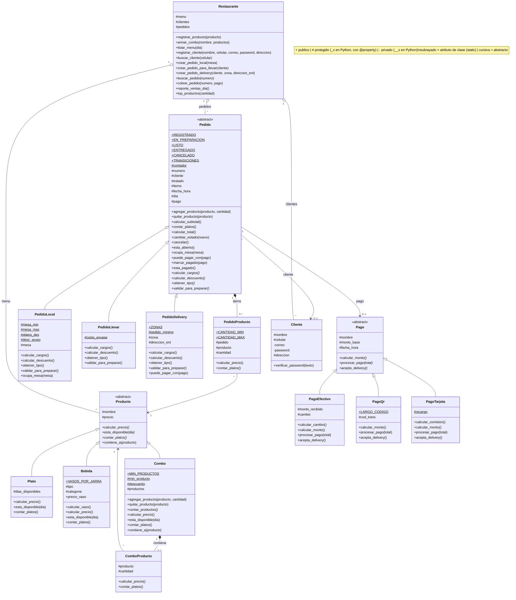

# Diagrama de clases v2 (generado desde el código)

Fuente de verdad: el código. Si cambia una clase, se actualiza este diagrama en el mismo commit.
GitHub dibuja el diagrama automáticamente. Para exportarlo a PNG: copiar el bloque en https://mermaid.live y descargar.

## Leyenda

| Símbolo | Significado | En Python |
| --- | --- | --- |
| `+` | público | métodos, properties y constantes en MAYÚSCULAS |
| `#` | protegido | `self._nombre`, se lee con `@property nombre` (si tiene setter, el setter valida) |
| `-` | privado | `self.__nombre` (name mangling); solo la propia clase lo usa |
| subrayado (`$`) | atributo de clase (static) | definido en la clase, compartido por todos los objetos |
| cursiva (`*`) / `<<abstract>>` | abstracto | `ABC` y `@abstractmethod` |

## Cambios respecto al diagrama v1 (aprobado)

1. Visibilidad unificada: atributos protegidos `#` con property (regla de encapsulación); `correo` y `password` de `Cliente` privados `-`.
2. `Combo.max_producto` → `min_producto`: en la variante D es el **mínimo** de productos (3) para el 15 % de descuento.
3. Se quita la herencia `Cliente → Pago` (un cliente no es un pago). `Pedido` se asocia con `Cliente` y con `Pago`.
4. Se quitan las líneas `ComboProducto — Pedido` y `PagoQr — Cliente` (el pedido usa `PedidoProducto`; el pago se asocia al pedido).
5. `PedidoProducto` agrega `cantidad` (1 a 20).
6. Se agregan los atributos y métodos que necesita la lógica (estados, `calcular_total`, `acepta_delivery`, etc.) y la clase `Restaurante` (gestor).
7. `Bebida` agrega `categoria`; `PedidoDelivery` agrega `zona` y `ZONAS`; `Cliente` agrega `verificar_password()`.

## Diagrama

