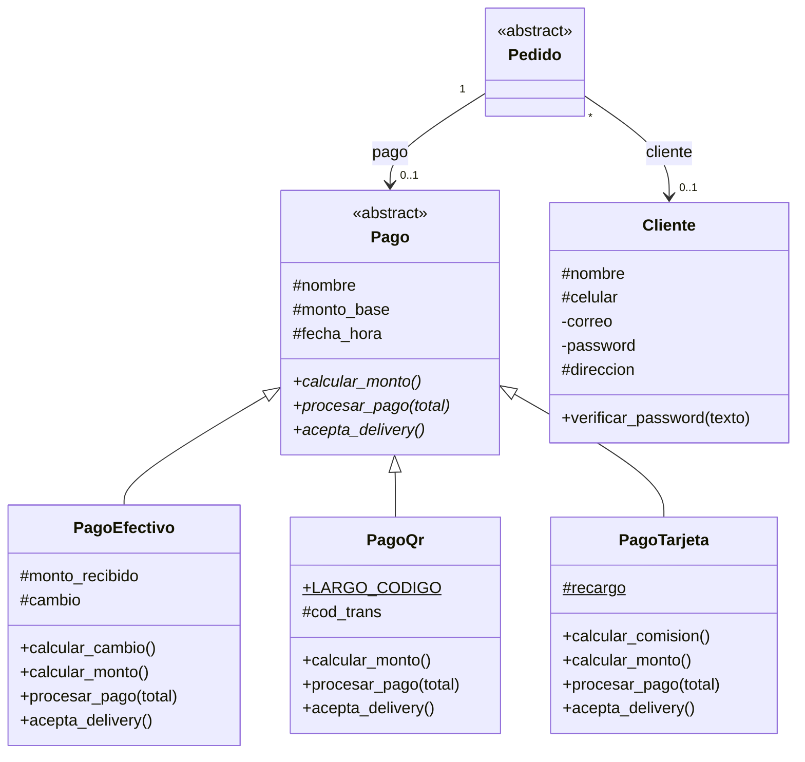

# Diagrama de clases v2 – Pagos y Clientes (generado desde el código)

Fuente de verdad: el código de `modelo/pagos.py` y `modelo/clientes.py`. Si cambia una clase, se actualiza este diagrama en el mismo commit.
GitHub dibuja el diagrama automáticamente. Para exportarlo a PNG: copiar el bloque en https://mermaid.live y descargar.

## Leyenda

| Símbolo | Significado | En Python |
| --- | --- | --- |
| `+` | público | métodos, properties y constantes en MAYÚSCULAS |
| `#` | protegido | `self._nombre`, se lee con `@property nombre` (si tiene setter, el setter valida) |
| `-` | privado | `self.__nombre` (name mangling); solo la propia clase lo usa |
| subrayado (`$`) | atributo de clase (static) | definido en la clase, compartido por todos los objetos |
| cursiva (`*`) / `<<abstract>>` | abstracto | `ABC` y `@abstractmethod` |

## Diagrama

`Pedido` aparece vacío solo para mostrar con qué se asocian `Cliente` y `Pago`; sus atributos y métodos están en el diagrama del módulo de pedidos.